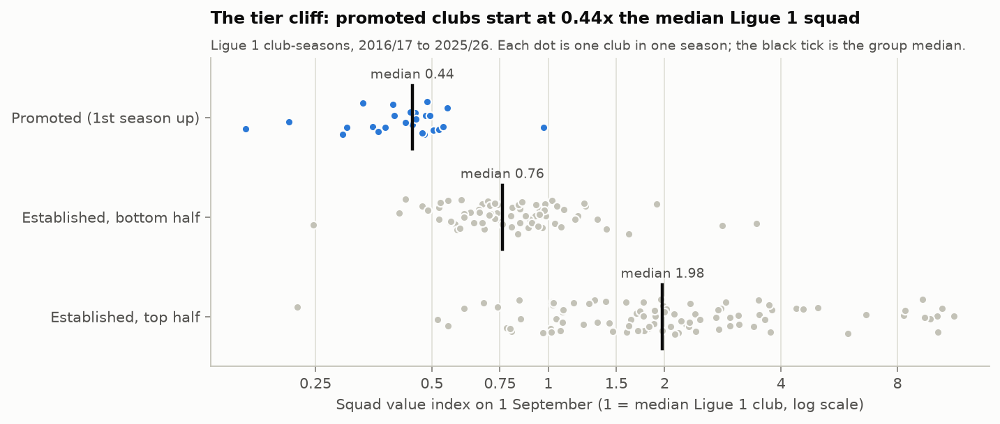
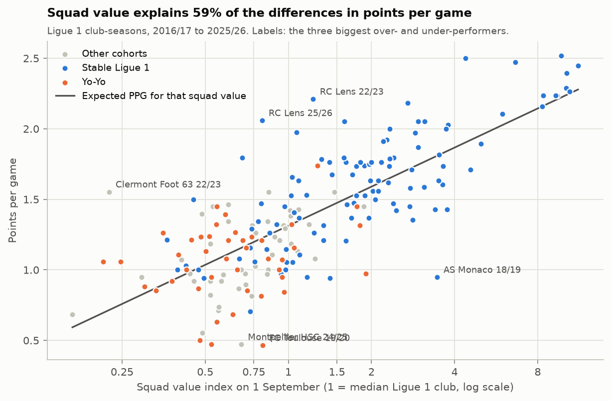
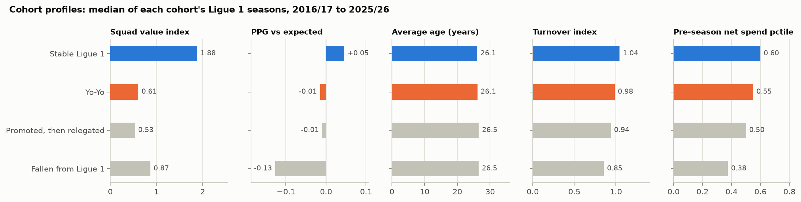
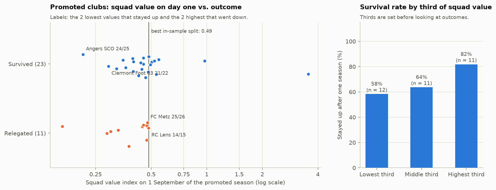
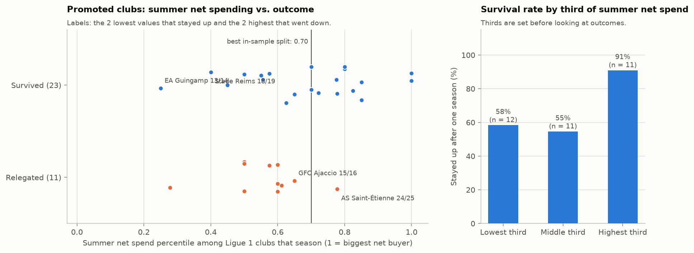
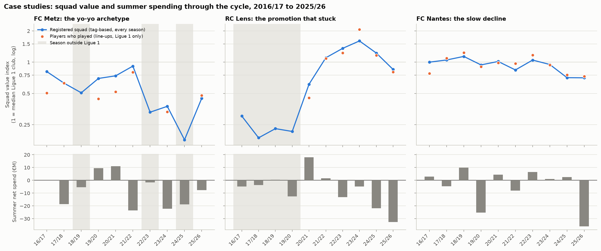

# Yo-Yo Clubs vs. Stable Ligue 1: what keeps a promoted club up?

A financial and squad-management analysis of French football clubs, 2016/17 to 2025/26, written from a
**management control** point of view: which KPIs separate the clubs that bounce between Ligue 1 and
Ligue 2 (*clubs ascenseurs*) from the clubs that settle in Ligue 1, and what a newly promoted club
should budget for to stay up.

Built in Python (pandas, SciPy, matplotlib) on the Transfermarkt dataset published on Kaggle
([davidcariboo/player-scores](https://www.kaggle.com/datasets/davidcariboo/player-scores)).

---

## Executive summary

**Bottom line: a promoted club does not stay up because of the squad it goes up with, but because of what
it adds in the summer.** Promoted clubs whose summer transfer balance beat the median promoted club stayed
in Ligue 1 **88% of the time (15 of 17)**, against **47% (8 of 17)** for the others.

| # | Finding | Key figure |
|---|---|---|
| 1 | **The tier cliff.** A promoted club starts the season with an eleven worth less than half of the median Ligue 1 squad. | 0.44x the median club; 58% of an established bottom-half club |
| 2 | **Stock beats flow.** Across the league, results follow squad value (a stock built over years) far more than one season's net spending (a flow). | Squad value explains 59% of the differences in points per game; rank correlation with results 0.73 for value vs 0.16 for net spend |
| 3 | **Yo-yo clubs are under-capitalised, not mismanaged.** Their squads are worth a third of stable clubs', but they earn the points that value predicts; age and turnover are the same. | Squad value index 0.61 vs 1.88; points vs expected -0.01 vs +0.05 |
| 4 | **After promotion, the summer window decides.** Starting value barely separates survivors (they all start in the same narrow band); summer net spend does, and the signal holds without January deals. | AUC 0.73 for summer net spend (90% interval 0.59-0.87) vs 0.64 for squad value (0.46-0.80) |
| 5 | **The benchmark is roughly a break-even summer.** The median Ligue 1 club is a net seller in the summer, so simply not selling more than it buys already puts a promoted club near the benchmark. | Benchmark: 64th percentile of Ligue 1 summer net spend |

**Recommendations for the management control of a newly promoted club**

1. **Ring-fence the first summer.** Budget a summer transfer balance at least at break-even. The extra
   revenue of promotion should fund the squad before anything else. Every Metz promotion that missed the
   benchmark ended in relegation (3 of 3); every one that met it survived (2 of 2).
2. **Manage squad value as an asset, not as a cost.** Lens invested €18M net in its promotion summer
   (2020), then grew its squad value index from 0.45 to 2.07 in three seasons. That asset later financed
   about €72M of net sales over four summers while the club kept finishing in the top 8.
3. **Install early-warning KPIs, even for "stable" clubs.** Nantes showed three red flags before its 2026
   relegation: points below what its squad value predicted in 4 consecutive seasons, a squad value index
   sliding below 0.8, then its biggest net-selling summer of the decade (-€35.9M).
4. **Set realistic targets.** With 0.44x the median squad, a promoted club's target is survival, and its
   performance should be judged against the points its squad value predicts, not against its raw rank.

These are correlations from 34 promotions, not proof of cause (see [Limitations](#limitations)).

---

## The question

> What financial and squad-management patterns distinguish French yo-yo clubs from teams that stabilise in
> Ligue 1, and is there a measurable squad valuation threshold or transfer strategy that predicts survival
> after promotion?

## Data and scope

- **Source:** Transfermarkt data (Kaggle, `davidcariboo/player-scores`), version ending 6 July 2026:
  games, line-ups, player valuations, transfers, clubs.
- **Clubs:** the 32 clubs that played Ligue 1 during the 10-season window 2016/17 to 2025/26.
- **League panel:** every Ligue 1 club-season from 2012/13 to 2025/26 (274 club-seasons), used for
  league-wide comparisons and the survival test (**34 promotions**, 11 relegated after one season).
- **What the data does not contain:** Ligue 2 and cup matches. Seasons outside Ligue 1 are observed only
  through transfers and valuations. Wages and revenues are not in the data.
- **One documented manual input:** the 2025/26 relegation play-off result (Nice stayed up), which the data
  stops before. Source: ligue1.com, list of play-off winners.

## Method

The project runs in four scripts, each one reading the outputs of the previous one.

| Step | Script | What it does |
|---|---|---|
| 1 | `step1_scope_audit.py` | Audits which competitions and seasons are covered, classifies clubs into cohorts, lists promotions. A reconciliation line checks that the cohort table and the promotion list agree. |
| 2 | `step2_kpi_master_table.py` | Builds the KPIs: a league panel (every Ligue 1 club-season), a master table (32 clubs x 10 seasons) and the promotion events. Prints validation checks against reality (champions, relegated clubs, landmark transfers). |
| 3 | `step3_analysis.py` | Tests the question: tier cliff, capital efficiency, cohort profiles, survival test with robustness checks. |
| 4 | `step4_case_studies.py` | Case studies: FC Metz, RC Lens, FC Nantes. |

**Cohorts** (one label per club, from its Ligue 1 trajectory over the window): *Stable Ligue 1* (12 clubs),
*Yo-Yo* (2 or more separate Ligue 1 spells, 7), *Promoted, then relegated* (7), *Fallen from Ligue 1* (5),
*Not classified yet* (promoted less than 3 seasons ago, 1).

**Main KPIs**

| KPI | Definition |
|---|---|
| Squad value index | Value on 1 September of the "average eleven on the pitch" (minutes-weighted market value x 11), divided by the median Ligue 1 club that season. 1.0 = median club. Comparable across years. |
| Points vs expected | Points per game minus what the club's squad value predicts (log-linear fit). Positive = over-performing its budget. |
| Summer net spend percentile | Transfer fees paid minus received in the summer window (deals dated up to 5 September), ranked among the Ligue 1 clubs of that season. |
| Turnover index | Share of league minutes played by the season's new signings, divided by the season median. |
| Average age | Minutes-weighted age on 1 September. |

**Design choices worth knowing**

- Squads are valued on **1 September**: the summer window is closed and no result is known yet, so the
  value is not contaminated by how the season went (no look-ahead bias).
- Squads are built from **line-ups** (players who actually played), because Step 1 showed that the club
  attached to a valuation is right only 65-86% of the time.
- Euro amounts are compared **within a season** (index, percentile), because player values inflate over
  time and older transfers are under-recorded.
- With small samples, the tests are **rank-based** (Mann-Whitney, Kruskal-Wallis), effect sizes come with
  **bootstrap** intervals, and the separating power of a KPI is measured with the **AUC**: the probability
  that a random survivor scores higher than a random relegated club (0.5 = coin flip; credit-risk teams
  use the same metric, Gini = 2 x AUC - 1).

---

## Findings

### 1. The tier cliff



The median promoted club fields an eleven worth **0.44x the median Ligue 1 club** (middle half: 0.36 to
0.49), against 0.76 for established clubs that finish in the bottom half. A random bottom-half club
out-values a random promoted club **93% of the time**.

### 2. Capital efficiency: stock beats flow



Doubling the squad value index is worth about **+0.28 points per game** (around 10 points over a
34-game season), and squad value explains **59%** of the differences in points per game. Net spending in
the same season barely correlates with results (0.16, against 0.73 for squad value).

- Biggest over-performers: Clermont 2022/23 (index 0.22, +0.84 PPG vs expected), Lens 2025/26 and
  2022/23, Brest 2023/24, Lille 2018/19.
- Biggest under-performer: Monaco 2018/19, with a squad worth 3.45x the median and 0.95 points per game.

### 3. Cohort profiles



| Cohort (Ligue 1 seasons) | Squad value index | Points vs expected | Average age | Summer net spend pctile |
|---|---|---|---|---|
| Stable Ligue 1 | 1.88 | +0.05 | 26.1 | 0.60 |
| Yo-Yo | 0.61 | -0.01 | 26.1 | 0.55 |
| Promoted, then relegated | 0.53 | -0.01 | 26.6 | 0.50 |
| Fallen from Ligue 1 | 0.87 | -0.13 | 26.5 | 0.38 |

Yo-yo clubs differ from stable clubs on squad value (p < 0.001), not on age or turnover. The clubs that
under-perform their budget are the *Fallen* ones (about -4 points a season), which also spend the least in
the summer. Caution: cohorts are defined by results, so this section describes rather than explains.

### 4. The survival test: what predicts staying up after promotion?




| Pre-season KPI | AUC, 34 promotions (90% interval) | AUC, 25 recent promotions |
|---|---|---|
| Net spend, full season | 0.78 (0.64-0.90), p = 0.01 | 0.81, p = 0.02 |
| **Net spend, summer only** | **0.73 (0.59-0.87), p = 0.03** | **0.73, p = 0.08** |
| Squad value index | 0.64 (0.46-0.80), p = 0.21 | 0.70, p = 0.14 |
| Turnover index | 0.63 (0.46-0.80), p = 0.22 | 0.60 |
| Average age | 0.45 (0.28-0.63), p = 0.66 | 0.41 |

- **Summer spending is the only KPI whose interval stays above 0.5.** Removing January deals (which can
  be a reaction to results) weakens it from 0.78 to 0.73, but it holds, including on recent promotions
  where transfer data is most complete.
- **Squad value points the right way but is not conclusive.** Survival rises from 58% to 64% to 82% across
  thirds of squad value, and all 8 promoted clubs at 0.49 or above stayed up, but the best cut-off is
  unstable (bootstrap range 0.32 to 0.49).
- **Survival by summer spending:** 58% / 55% / **91%** by third; **88% vs 47%** above vs below the median
  promoted club.
- **Squad value x summer spending** (small cells, indicative): stronger squad + above-median spending 9 of
  9 survived; stronger squad + below-median spending 38%; weaker squad + above-median spending 75%.

### 5. Case studies



**FC Metz, the yo-yo archetype.** Five promotions since 2014/15, always with a similar squad (index 0.33
to 0.50). The two summers that beat the spending benchmark (2016/17, 2019/20) led to survival; the three
that missed it (2014/15, 2023/24, 2025/26) led straight back down. Three of its relegations in the window
followed clearly net-selling summers (-€18.6M in 2017/18, -€23.5M in 2021/22, -€22.2M in 2023/24): a "sell
to balance the books, go down, come back up" cycle. In 2025/26, spending was just below the benchmark, and the team also earned
far fewer points than its squad predicted (0.50 per game, -0.52 vs expected).

**RC Lens, the promotion that stuck.** Lens went up twice with the same starting value: 0.48 in 2014/15
and 0.45 in 2020/21. In 2014/15 it stayed below the spending benchmark, almost none of its new signings
played, and it finished last. In 2020/21 it spent €18M net in the summer, gave its new signings about twice
the league's usual share of minutes (turnover index 1.94), and finished 7th. Three seasons later its
squad value index had reached 2.07. Lens then became a net seller (about -€72M over four summers) while
finishing 2nd, 7th, 8th and 2nd: the promotion was treated as an investment, and the asset was later
monetised.

**FC Nantes, the slow decline.** Ten seasons in Ligue 1, labelled *Stable*, then relegated at the end
of 2025/26. The warning signs were visible years ahead: points below expectation in 5 of its last 6
seasons (4 in a row), a squad value index falling from 1.24 (2018/19) to 0.73, and finally its biggest
net-selling summer of the decade (-€35.9M, 28th percentile).

---

## Limitations

- **Small sample.** 34 promotions, 11 of them relegated after one season: the results are evidence, not
  proof. P-values are indicative, and seasons of the same club are not independent observations.
- **Correlation, not causation.** A club able to spend in the summer may also have a richer owner, better
  recruitment or more stable management. The data cannot separate these.
- **No wages or revenues.** Wages are a club's biggest cost and probably a large part of the story.
- **Market values are estimates** (Transfermarkt), not accounting values.
- **Older transfer data is incomplete.** For example, PSG's signing of David Luiz in summer 2014 is
  missing. Spending results are therefore also reported on recent promotions only.
- **No Ligue 2 or cup matches.** Ligue 2 seasons are seen only through transfers and valuations.
- **Squad composition includes January signings.** The squad is built from the players who actually
  played during the season, valued on 1 September.
- **Simplified tie-break.** Computed tables rank on points, goal difference and goals scored; official
  tables can differ (e.g. 2023/24, where Metz finished ahead of Lorient on head-to-head results).

## Reproduce the analysis

```bash
python -m venv .venv
# Windows: .venv\Scripts\activate    macOS/Linux: source .venv/bin/activate
pip install -r requirements.txt
```

Download the dataset from [Kaggle](https://www.kaggle.com/datasets/davidcariboo/player-scores) and put
these files in `data/`: `competitions.csv`, `clubs.csv`, `games.csv`, `appearances.csv`, `players.csv`,
`player_valuations.csv`, `transfers.csv`. Then run, from the repository root:

```bash
python step1_scope_audit.py
python step2_kpi_master_table.py
python step3_analysis.py
python step4_case_studies.py
```

Outputs (CSV tables and charts) are written to `outputs/`. With a newer version of the dataset, the window
moves forward automatically; the manual play-off input in Step 2 (`PLAYOFF_CLUB_RELEGATED`) applies only to
2025/26.

## Repository structure

```
├── data/                        # raw Kaggle CSVs (not versioned)
├── outputs/
│   ├── figures/                 # charts used in this README
│   └── step*_*.csv              # cohort table, KPI tables, promotion events
├── step1_scope_audit.py
├── step2_kpi_master_table.py
├── step3_analysis.py
├── step4_case_studies.py
├── requirements.txt
└── README.md
```

---

*Author: Antoine Longour, MSc Data and AI for Finance @ Albert School (Paris), interested in management control in the sports 
industry. [LinkedIn](https://www.linkedin.com/in/antoine-longour-228a09255/)*
